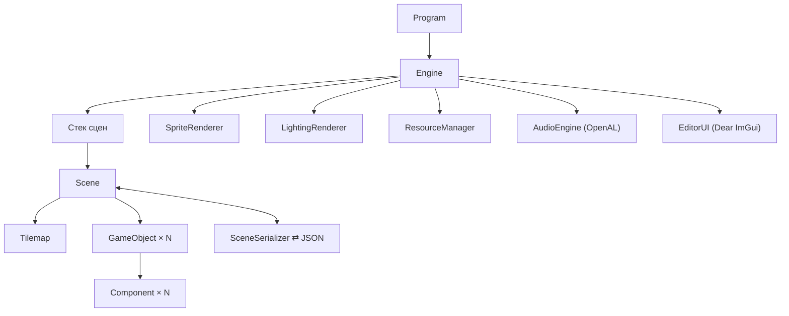
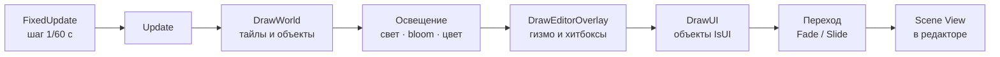

<div align="center">

# ef2dg

**Самописный 2D-движок и визуальный редактор на C#**

Компонентная архитектура · JSON-сцены · тайлмапы с физикой · освещение с bloom · встроенный редактор на Dear ImGui


[Возможности](#возможности) · [Быстрый старт](#быстрый-старт) · [Архитектура](#архитектура) · [Редактор](#редактор) · [Документация](#документация)

</div>

---

## О проекте

`ef2dg` — движок для 2D-игр с видом сбоку и сверху. Он создаёт окно OpenGL 3.3, ведёт игровой цикл с фиксированным шагом физики и сразу открывает редактор: сцену можно собрать мышью, настроить компоненты в инспекторе, нарисовать карту тайлами, расставить свет и запустить игру кнопкой **Play** в том же окне.

Поведение объектов задаётся компонентами. Новый компонент — это обычный C#-класс: после сборки он сам появляется в меню **Add Component**, а его публичные свойства — в инспекторе и в JSON уровня.

## Возможности

| Подсистема | Что умеет |
|---|---|
| **Сцены и компоненты** | `Scene` → `GameObject` → `Component`; стек сцен `ChangeScene` / `PushScene` / `PopScene`; отсечение обновления вне камеры и флаг `AlwaysActive` |
| **Сериализация** | JSON-уровни через reflection: `float`, `bool`, `int`, `string`, `Vector2D`, `Vector4D`, `TransitionSettings`; тайлы, их настройки и освещение сцены; атрибут `[SceneTransient]` для runtime-полей |
| **Рендер** | динамический sprite batch до 2048 спрайтов и 16 текстур за draw call, отдельный batch одноцветного UI, отладочная геометрия; счётчики `Draws`/`Quads` |
| **Освещение** | своё у каждой сцены: HDR-карта света, ядро свечения, bloom, экспозиция, контраст, насыщенность, тонирование, виньетка; источники с мерцанием и пульсацией; пресеты локаций |
| **Тайлмап** | слои `Background` / `Ground` / `Foreground`, коллизии `Solid` и склоны, масштаб, смещение, отражение и анимация тайлов |
| **Физика** | кинематический `PhysicsBody` с AABB: платформер с гравитацией и склонами или вид сверху; триггеры `OnTriggerEnter/Stay/Exit` |
| **Анимация** | `SpriteComponent` со state machine: параметры, условия переходов, `ExitTime`, звуки на кадрах |
| **Аудио** | OpenAL: 16 каналов эффектов с позиционированием и отдельная музыка (PCM WAV) |
| **Переходы** | `Instant`, `Fade`, `CrossFade`, `SlideLeft/Right/Up/Down` для смены сцен, оверлеев и телепортов |
| **Ввод** | логические действия с переназначением в `bindings.json`; координаты мыши для игрового UI внутри окна сцены |
| **Игровой UI** | объекты с `IsUI` рисуются экранной камерой поверх мира и освещения |

## Быстрый старт

**Требования:** .NET SDK 10, видеодрайвер с OpenGL 3.3, аудиоустройство для OpenAL. Проверено на Windows.

```powershell
git clone https://github.com/InfinitiveP/ef2dg.git
cd ef2dg
dotnet run
```

Запускайте из каталога проекта: конфигурация, уровни, шейдеры и `assets/` читаются относительными путями.

Первые шаги в редакторе:

1. `File → New Scene` или `File → Open...` (`Ctrl+O`).
2. `Ctrl+Shift+N` — новый объект; в **Inspector** нажмите **Add Component**.
3. В **Tile Palette** выберите тайл и рисуйте в **Scene View**.
4. Окно **Lighting** — пресет освещения и **+ Добавить источник света**.
5. `Ctrl+S` — сохранить, `Ctrl+P` — Play / Stop.

> [!WARNING]
> Play Mode работает на той же сцене, что и редактор, и не откатывает её после **Stop**. Сохраняйте уровень до запуска и не сохраняйте его во время игры — иначе в JSON попадёт runtime-состояние.

## Архитектура



### Кадр



Физика идёт с фиксированным шагом, накопитель ограничен 0,25 с. Свет ложится только на мир: гизмо редактора и игровой HUD рисуются поверх него. Смена сцен откладывается до конца кадра.

### Свой компонент

```csharp
namespace ef2dg
{
    public class HealthComponent : Component
    {
        public int MaxHealth { get; set; } = 100;     // видно в Inspector и сохраняется в JSON
        public int CurrentHealth { get; set; } = 100;

        public HealthComponent() { }                  // нужен редактору и загрузчику

        public override void Update(float deltaTime)
        {
            if (CurrentHealth < 0) CurrentHealth = 0;
        }
    }
}
```

Компонент должен лежать в namespace `ef2dg` и иметь публичный конструктор без параметров. `Start()` при загрузке вызывается **до** восстановления свойств из JSON — подробности в [руководстве по компонентам](obsidian/ef2dg_Docs/05_Guides/Разработка%20компонентов.md).

## Редактор

| Окно | Назначение |
|---|---|
| **Scene View** | вкладки сцен, выбор и перетаскивание объектов, рисование тайлов, zoom колесом |
| **Hierarchy** | список объектов, порядок отрисовки, создание и удаление |
| **Inspector** | transform, `IsUI`, `AlwaysActive` и свойства компонентов через reflection |
| **Tile Palette** | слои, кисть, коллизии и анимация тайлов |
| **Lighting** | освещение сцены, пресеты, добавление источников |
| **Asset Browser** | ресурсы проекта, предпросмотр, импорт перетаскиванием файлов |
| **Console** | вывод `Console.WriteLine` с подсветкой ошибок |
| **Project Settings** | масштаб камеры, цвет фона, привязки клавиш |

| Клавиши | Действие |
|---|---|
| `Ctrl+S` / `Ctrl+Shift+S` / `Ctrl+O` | сохранить / сохранить как / открыть сцену |
| `Ctrl+Z` / `Ctrl+Y` | отмена / повтор (рисование тайлов) |
| `Ctrl+P` | Play / Stop |
| `Ctrl+Shift+N` | новый объект |
| `W` `A` `S` `D` | камера редактора |
| `F1`–`F4` | хитбоксы игрока, объектов, карты и зоны атак |
| `F5` | монитор производительности: FPS, frame time, `Draws`, `Quads` |

## Структура

```text
Core/         движок, игровой цикл, ввод, конфигурация, переходы
Framework/    Scene, GameObject, Component, SceneSerializer, Tilemap, SceneLighting
Rendering/    камера, шейдеры, текстуры, framebuffer, SpriteRenderer, LightingRenderer
Components/   SpriteComponent, PhysicsBody, BoxCollider, LightComponent, AudioSource, частицы, кнопки
Editor/       окна редактора Dear ImGui
Audio/        OpenAL-аудио
Scenes/       UIScene
Game/         пример: GameScene, PlayerController, EnemyAIComponent, триггеры
Shaders/      освещение и постобработка
obsidian/     техническая вики (Obsidian vault)
```

## Документация

Полная вики лежит в [`obsidian/ef2dg_Docs`](obsidian/ef2dg_Docs/00_Dashboard/00_Main.md) — её можно читать прямо на GitHub или открыть папку как vault в [Obsidian](https://obsidian.md).

- [Начало работы](obsidian/ef2dg_Docs/05_Guides/Начало%20работы.md)
- [Полное руководство по редактору](obsidian/ef2dg_Docs/04_Editor_Tools/Полное%20руководство%20по%20редактору.md)
- [Разработка компонентов](obsidian/ef2dg_Docs/05_Guides/Разработка%20компонентов.md)
- [Формат уровня и сериализация](obsidian/ef2dg_Docs/03_Modules/Формат%20уровня%20и%20сериализация.md)
- [Освещение](obsidian/ef2dg_Docs/05_Guides/Освещение.md)
- [Переходы между локациями](obsidian/ef2dg_Docs/05_Guides/Переходы%20между%20локациями.md)
- [Ограничения и диагностика](obsidian/ef2dg_Docs/05_Guides/Ограничения%20и%20диагностика.md)

## Известные ограничения

- Play Mode не изолирован от редактора; Undo/Redo — только для тайлов.
- Аудио декодирует только PCM WAV.
- `BoxCollider` без `IsTrigger` не останавливает `PhysicsBody`: твёрдые препятствия задаёт тайлмап.
- Тени не рассчитываются, свет проходит сквозь стены.
- Ссылки между объектами и приватное состояние компонентов в JSON не сохраняются.

## Зависимости

[Silk.NET](https://github.com/dotnet/Silk.NET) (OpenGL, GLFW, Input, OpenAL), [ImGui.NET](https://github.com/ImGuiNET/ImGui.NET), [StbImageSharp](https://github.com/StbSharp/StbImageSharp), [Newtonsoft.Json](https://www.newtonsoft.com/json). Резервный шрифт редактора — [Roboto](https://fonts.google.com/specimen/Roboto).

## Лицензия

Код движка распространяется по лицензии [MIT](LICENSE). Тестовые изображения в `assets/` — простые заглушки, созданные для движка, и распространяются вместе с кодом. Шрифт Roboto © The Roboto Project Authors распространяется по [SIL Open Font License 1.1](https://openfontlicense.org).
