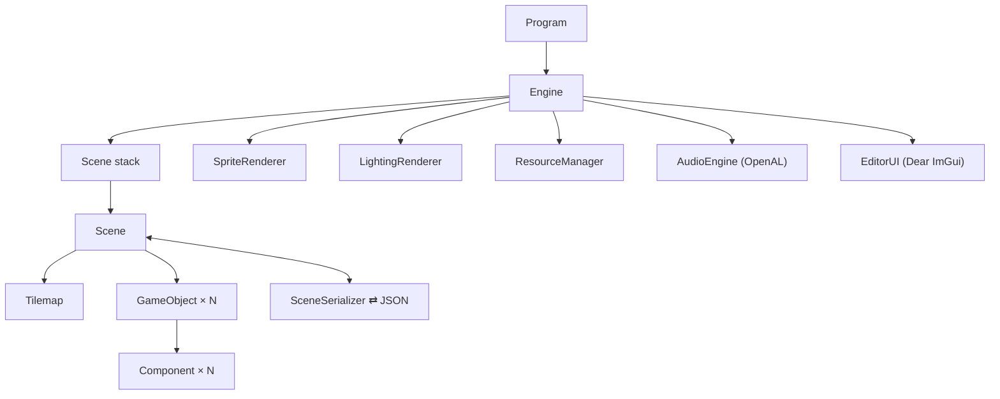
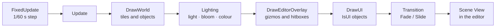

<div align="center">

# ef2dg

**English** · [Русский](README.ru.md)

**A custom 2D game engine and visual editor written in C#**

Component architecture · JSON scenes · tilemaps with physics · lighting with bloom · built-in Dear ImGui editor


[Features](#features) · [Quick start](#quick-start) · [Architecture](#architecture) · [Editor](#editor) · [Documentation](#documentation)

</div>

---

## About

`ef2dg` is an engine for side-view and top-down 2D games. It opens an OpenGL 3.3 window, runs a game loop with fixed-step physics and starts straight into the editor: build a scene with the mouse, tweak components in the Inspector, paint the map with tiles, place lights and hit **Play** — all in the same window.

Object behaviour is defined by components. A new component is a plain C# class: after a build it shows up in the **Add Component** menu by itself, and its public properties appear in the Inspector and in the level JSON.

## Features

| Subsystem | What it does |
|---|---|
| **Scenes and components** | `Scene` → `GameObject` → `Component`; a scene stack with `ChangeScene` / `PushScene` / `PopScene`; update culling outside the camera and the `AlwaysActive` flag |
| **Serialization** | reflection-based JSON levels: `float`, `bool`, `int`, `string`, `Vector2D`, `Vector4D`, `TransitionSettings`; tiles, their settings and scene lighting; the `[SceneTransient]` attribute for runtime-only members |
| **Rendering** | a dynamic sprite batch of up to 2048 sprites and 16 textures per draw call, a separate solid-colour UI batch, debug geometry; `Draws`/`Quads` counters |
| **Lighting** | per scene: HDR light map, glowing cores, bloom, exposure, contrast, saturation, tint, vignette; flickering and pulsing light sources; location presets |
| **Tilemap** | `Background` / `Ground` / `Foreground` layers, `Solid` and slope collisions, tile scale, offset, flipping and animation |
| **Physics** | kinematic AABB `PhysicsBody`: a platformer with gravity and slopes or a top-down view; `OnTriggerEnter/Stay/Exit` triggers |
| **Animation** | `SpriteComponent` with a state machine: parameters, transition conditions, `ExitTime`, per-frame sounds |
| **Audio** | OpenAL: 16 positional effect channels plus a separate music source (PCM WAV) |
| **Transitions** | `Instant`, `Fade`, `CrossFade`, `SlideLeft/Right/Up/Down` for scene changes, overlays and teleports |
| **Input** | rebindable logical actions in `bindings.json`; mouse coordinates for in-game UI inside the scene view |
| **In-game UI** | `IsUI` objects are drawn with a screen camera on top of the world and the lighting |

## Quick start

**Requirements:** .NET SDK 10, a GPU driver with OpenGL 3.3, an audio device for OpenAL. Tested on Windows.

```powershell
git clone https://github.com/InfinitiveP/ef2dg.git
cd ef2dg
dotnet run
```

Run from the project folder: configuration, levels, shaders and `assets/` are read through relative paths.

First steps in the editor:

1. `File → New Scene` or `File → Open...` (`Ctrl+O`).
2. `Ctrl+Shift+N` creates an object; press **Add Component** in the **Inspector**.
3. Pick a tile in **Tile Palette** and paint in the **Scene View**.
4. In the **Lighting** window choose a preset and press **+ Добавить источник света** (add light source).
5. `Ctrl+S` saves, `Ctrl+P` toggles Play / Stop.

> [!WARNING]
> Play Mode runs on the same scene as the editor and does not roll it back after **Stop**. Save the level before playing and never save it during play — otherwise runtime state ends up in the JSON.

## Architecture



### Frame



Physics runs at a fixed step with the accumulator capped at 0.25 s. Light affects only the world: editor gizmos and the game HUD are drawn on top of it. Scene changes are deferred to the end of the frame.

### Your own component

```csharp
namespace ef2dg
{
    public class HealthComponent : Component
    {
        public int MaxHealth { get; set; } = 100;     // visible in the Inspector and saved to JSON
        public int CurrentHealth { get; set; } = 100;

        public HealthComponent() { }                  // required by the editor and the loader

        public override void Update(float deltaTime)
        {
            if (CurrentHealth < 0) CurrentHealth = 0;
        }
    }
}
```

A component must live in the `ef2dg` namespace and have a public parameterless constructor. On load, `Start()` is called **before** properties are restored from JSON — see the [component guide](obsidian/ef2dg_Docs_en/05_Guides/Component%20Development.md) for details.

## Editor

| Window | Purpose |
|---|---|
| **Scene View** | scene tabs, selecting and dragging objects, tile painting, wheel zoom |
| **Hierarchy** | object list, draw order, creating and deleting |
| **Inspector** | transform, `IsUI`, `AlwaysActive` and component properties through reflection |
| **Tile Palette** | layers, brush, tile collisions and animation |
| **Lighting** | scene lighting, presets, adding light sources |
| **Asset Browser** | project resources, previews, import by dropping files |
| **Console** | `Console.WriteLine` output with error highlighting |
| **Project Settings** | camera zoom, background colour, key bindings |

| Keys | Action |
|---|---|
| `Ctrl+S` / `Ctrl+Shift+S` / `Ctrl+O` | save / save as / open a scene |
| `Ctrl+Z` / `Ctrl+Y` | undo / redo (tile painting) |
| `Ctrl+P` | Play / Stop |
| `Ctrl+Shift+N` | new object |
| `W` `A` `S` `D` | editor camera |
| `F1`–`F4` | player, object and map hitboxes, attack zones |
| `F5` | performance monitor: FPS, frame time, `Draws`, `Quads` |

## Project layout

```text
Core/         engine, game loop, input, configuration, transitions
Framework/    Scene, GameObject, Component, SceneSerializer, Tilemap, SceneLighting
Rendering/    camera, shaders, textures, framebuffers, SpriteRenderer, LightingRenderer
Components/   SpriteComponent, PhysicsBody, BoxCollider, LightComponent, AudioSource, particles, buttons
Editor/       Dear ImGui editor windows
Audio/        OpenAL audio
Scenes/       UIScene
Game/         example: GameScene, PlayerController, EnemyAIComponent, triggers
Shaders/      lighting and post-processing
obsidian/     technical wiki: ef2dg_Docs_en (English) and ef2dg_Docs (Russian)
```

## Documentation

The full wiki is available in English in [`obsidian/ef2dg_Docs_en`](obsidian/ef2dg_Docs_en/00_Dashboard/00_Main.md) and in Russian in [`obsidian/ef2dg_Docs`](obsidian/ef2dg_Docs/00_Dashboard/00_Main.md). Read it right here on GitHub or open the folder as a vault in [Obsidian](https://obsidian.md). Every note starts with a link to the same note in the other language.

- [Getting Started](obsidian/ef2dg_Docs_en/05_Guides/Getting%20Started.md)
- [Complete Editor Guide](obsidian/ef2dg_Docs_en/04_Editor_Tools/Complete%20Editor%20Guide.md)
- [Component Development](obsidian/ef2dg_Docs_en/05_Guides/Component%20Development.md)
- [Level Format and Serialization](obsidian/ef2dg_Docs_en/03_Modules/Level%20Format%20and%20Serialization.md)
- [Lighting](obsidian/ef2dg_Docs_en/05_Guides/Lighting.md)
- [Scene Transitions](obsidian/ef2dg_Docs_en/05_Guides/Scene%20Transitions.md)
- [Limitations and Diagnostics](obsidian/ef2dg_Docs_en/05_Guides/Limitations%20and%20Diagnostics.md)

## Known limitations

- Play Mode is not isolated from the editor; Undo/Redo covers tiles only.
- Audio decodes PCM WAV only.
- A `BoxCollider` without `IsTrigger` does not stop a `PhysicsBody`: solid obstacles come from the tilemap.
- No shadows: light passes through walls.
- References between objects and private component state are not saved to JSON.
- Source code comments and some Lighting window labels are still in Russian.

## Dependencies

[Silk.NET](https://github.com/dotnet/Silk.NET) (OpenGL, GLFW, Input, OpenAL), [ImGui.NET](https://github.com/ImGuiNET/ImGui.NET), [StbImageSharp](https://github.com/StbSharp/StbImageSharp), [Newtonsoft.Json](https://www.newtonsoft.com/json). The editor's fallback font is [Roboto](https://fonts.google.com/specimen/Roboto).

## License

The engine code is released under the [MIT License](LICENSE). The test images in `assets/` are simple placeholders made for the engine and are distributed with the code. The Roboto font © The Roboto Project Authors is licensed under the [SIL Open Font License 1.1](https://openfontlicense.org).
